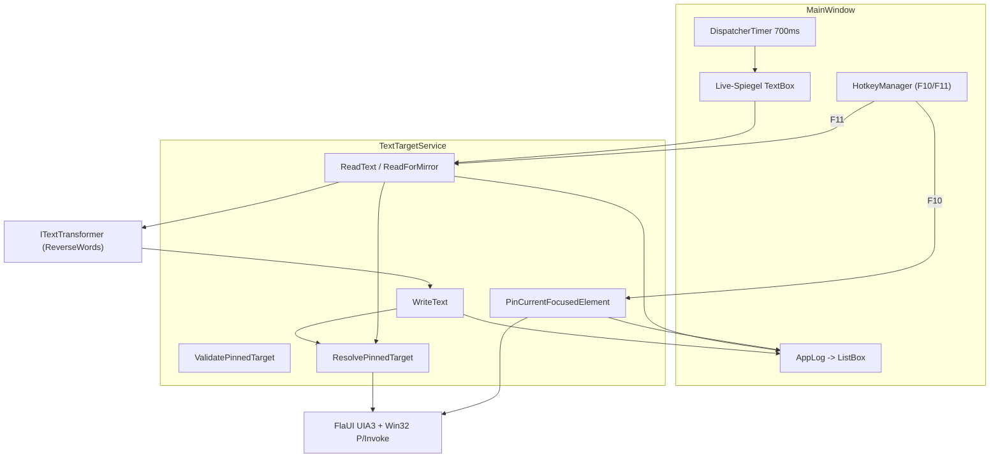
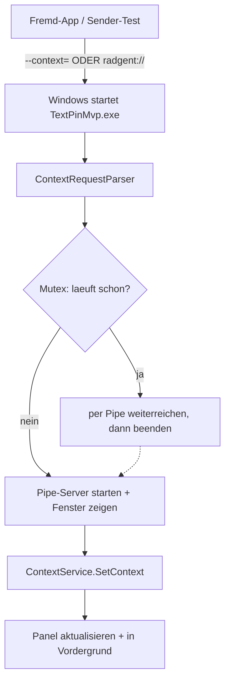

# TextPinMvp - Text-Pinning MVP (WPF + FlaUI)

> Debug-/Test-Anwendung, die ein Textfeld einer **beliebigen fremden Windows-App**
> per Hotkey fixiert ("pinnt"), dessen Inhalt ausliest, transformiert (aktuell:
> Dummy "jedes Wort rueckwaerts") und wieder in genau dieses Feld zurueckschreibt.
> Vorbild: Diktier-/Assistenzsoftware wie Dragon/DMO. Eine spaetere LLM-Anbindung
> ist ueber eine Schnittstelle vorbereitet.

Dieses README richtet sich an **Menschen und andere Coding-Agents**. Es beschreibt
Architektur, Datenfluss, die Zugriffsstrategien, bekannte Probleme und Erweiterungspunkte
so genau, dass man ohne Vorwissen weiterarbeiten kann.

---

## 1. Zweck und Kernidee

Der Nutzer klickt in ein Textfeld einer Zielanwendung (Notepad, Word, Browser,
Praxissoftware ...), drueckt **F10** (Feld fixieren) und danach **F11**
(lesen -> transformieren -> zurueckschreiben). Die App zeigt zu jedem Schritt
ausfuehrliches **Debug-Feedback** in einem Live-Log und einem Live-Spiegel.

Das eigentliche technische Risiko ist der Zugriff auf **fremde** Textfelder. Es gibt
kein universelles API, das in allen Apps funktioniert. Deshalb wird eine
**Fallback-Kette** aus mehreren Strategien verwendet (siehe Abschnitt 5).

---

## 2. Tech-Stack

- **.NET 8** (`net8.0-windows`), **WPF** (nur Windows).
- **FlaUI.UIA3** (NuGet, v4.0.0) als Wrapper um Microsoft UI Automation (UIA3/COM).
- **P/Invoke** gegen `user32`/`kernel32` fuer globale Hotkeys, Win32-Text-Messages,
  Fenster-/Fokus-Handling und Tastatursimulation (`SendInput`).
- Kein zusaetzlicher Build-Schritt, keine externen Tools noetig.

Voraussetzung zum Bauen: .NET 8 SDK (`dotnet --version` >= 8.0).

---

## 3. Projektstruktur (Dateikarte)

Ein einzelnes WPF-Projekt (bewusst kein Multi-Projekt-Overkill fuer ein MVP):

```
TextPinMvp.csproj            # WPF, net8.0-windows, PackageReference FlaUI.UIA3
App.xaml / App.xaml.cs       # WPF-Einstieg, StartupUri = MainWindow.xaml
MainWindow.xaml              # UI: Header, Status, Buttons, Live-Spiegel + Log (Splitter)
MainWindow.xaml.cs           # UI-Logik: Hotkeys verdrahten, Aktionen, Mirror-Polling

Interop/
  Win32.cs                   # P/Invoke-Definitionen + Helfer (Hotkey, SendMessage, SendInput)
  HotkeyManager.cs           # globale Hotkeys via HwndSource-Hook

Models/
  PinnedTextTarget.cs        # Descriptor des fixierten Felds (viele Identifikationsmerkmale)
  TextSelectionInfo.cs       # Selektions-/Cursor-Info
  AccessResult.cs            # Ergebnis eines Lese-/Schreibversuchs (Strategie/Erfolg/Fehler)

Services/
  TextTargetService.cs       # KERNLOGIK: Pin, Validate, Resolve, Read, Write, Mirror
  AppLog.cs                  # an die UI gebundener Log-Sink (ObservableCollection)

Transform/
  ITextTransformer.cs        # Schnittstelle: Task<string> TransformAsync(string)
  ReverseWordsTransformer.cs # Dummy-Implementierung (jedes Wort rueckwaerts)
```

Generierte Ordner (nicht eingecheckt relevant): `bin/`, `obj/`.

---

## 4. Architektur und Datenfluss



Zwei austauschbare Abstraktionen:

- `ITextTransformer` - heute Dummy, spaeter LLM (gleiche Stelle, kein Umbau noetig).
- Die Strategie-Fallback-Kette in `TextTargetService` - kapselt das App-spezifische
  Lesen/Schreiben.

---

## 5. Die Zugriffsstrategien (wichtigster Teil)

Alle Methoden geben ein `AccessResult` zurueck (`Success`, `Strategy`, `Text`, `Error`),
damit im Log immer sichtbar ist, **welche** Strategie gegriffen hat.

### 5.1 Pinning (F10) - `PinCurrentFocusedElement()`

1. `UIA3Automation.FocusedElement()` liefert das aktuell fokussierte Element der
   **fremden** App (unsere App hat den Fokus nicht, weil F10 ein globaler Hotkey ist).
2. `BuildTarget(...)` baut einen `PinnedTextTarget` mit vielen Merkmalen:
   ProcessId/Name, TopLevelHwnd/Title, ControlHwnd, RuntimeId, AutomationId, Name,
   ClassName, ControlType, BoundingRectangle, unterstuetzte Patterns
   (Value/Text/Legacy + ob Value read-only), aktueller Text + Selektion.
3. Zusaetzlich wird die **lebende `AutomationElement`-Referenz** in `_pinnedElement`
   zwischengespeichert (kritisch fuer windowless WPF-Controls, siehe 5.2).

### 5.2 Wiederfinden - `ValidatePinnedTarget()` + `ResolvePinnedTarget(bool quiet)`

Warum noetig: HWND kann ungueltig werden, RuntimeId ist nur zur Laufzeit gueltig,
AutomationId ist nicht global eindeutig, Controls werden bei Tab-/Dialogwechsel neu erzeugt.

`ResolvePinnedTarget` versucht in dieser Reihenfolge:

1. **Direkt ueber `ControlHwnd`** (klassische Win32-Controls), wenn HWND noch gueltig
   ist und zum erwarteten Prozess gehoert: `automation.FromHandle(hwnd)`.
2. **Zwischengespeichertes `_pinnedElement`**, falls es noch "lebt"
   (`IsElementAlive` liest testweise eine Property). Das ist der entscheidende Pfad
   fuer **windowless WPF-Controls** (`ControlHwnd == 0`), die nach Fokusverlust per
   Komplettsuche oft nicht mehr gefunden werden.
3. **Neusuche im Top-Level-Fenster** (`ReSearchInWindow`):
   - Schnellpfad: native Suche per `FindAllDescendants(cf => cf.ByAutomationId(...))`.
   - Fallback: kompletter `FindAllDescendants()`-Walk (langsam).
   - Kandidaten werden gescoort (`ScoreCandidate`): AutomationId +5, ControlType +2,
     ClassName +2, Name +2, Position (weicher Tiebreak) +1, nicht-textfaehig -1.
   - Bei mehreren gleich plausiblen Treffern (Ambiguitaet, Score < 5): **kein** Ziel,
     Nutzer soll erneut fixieren (keine stillen Writes ins falsche Feld).

### 5.3 Lesen - `ReadText()`

Fallback-Kette (erste erfolgreiche gewinnt):

1. UIA **ValuePattern** (`Value`)
2. UIA **TextPattern** (`DocumentRange.GetText(-1)`)
3. UIA **LegacyIAccessible** (`Value`)
4. **Win32** `WM_GETTEXTLENGTH`/`WM_GETTEXT` (nur wenn ClassName nach Edit/RichEdit aussieht)
5. **Clipboard** (Ziel fokussieren -> `Ctrl+A`/`Ctrl+C` -> Clipboard lesen -> Backup wiederherstellen)

### 5.4 Schreiben - `WriteText(string)`

Fallback-Kette:

1. UIA **`ValuePattern.SetValue`** (wenn nicht read-only) - ersetzt den ganzen Inhalt, kein Fokus noetig.
2. **Win32** `WM_SETTEXT` (nur Edit/RichEdit).
3. **Clipboard-Paste** (Ziel fokussieren -> Clipboard setzen -> `Ctrl+A` -> `Ctrl+V` -> Backup wiederherstellen).

### 5.5 Live-Spiegel - `ReadForMirror()`

Wie `ReadText`, aber **bewusst OHNE Clipboard und OHNE Fokuswechsel** (nur Value/Text/
Legacy/Win32). Grund: Der Spiegel pollt alle 700 ms; ein Clipboard-Fallback wuerde
staendig `Ctrl+A/Ctrl+C` ausloesen und die Selektion/den Fokus im Zielfeld zerstoeren.
Apps, die nur per Clipboard lesbar waeren, zeigen daher "nicht spiegelbar".

---

## 6. Hotkeys und UI

- **F10** = Feld fixieren, **F11** = transformieren (lesen -> Dummy -> schreiben).
  Beide sind auch als Buttons vorhanden (Auslosung per Button kann den Clipboard-Pfad
  beeintraechtigen, siehe Bekannte Probleme).
- Globale Registrierung: `HotkeyManager` haengt sich per `HwndSource.AddHook` an die
  Fenster-Prozedur und nutzt `RegisterHotKey` (mit `MOD_NOREPEAT`). IDs ab 9000.
- UI (`MainWindow.xaml`): Statusleiste (Kurzbeschreibung des Ziels), links der
  **Live-Spiegel** (read-only TextBox + Status), rechts das **Log** (farbcodiert nach
  LogLevel), dazwischen ein `GridSplitter`. Buttons: Fixieren, Transformieren,
  Nur lesen, Ziel loeschen, Log kopieren, Log leeren.
- Threading: Hotkey-Callbacks und Mirror-Tick laufen auf dem UI-Thread (STA). UIA-Calls
  werden synchron auf dem UI-Thread ausgefuehrt; die Transformation ist `async`.
  `_busy`/`_mirrorBusy` verhindern Ueberlappung.

---

## 7. Build, Run, Publish

### Bauen / Starten (Entwicklung)

```powershell
dotnet build
dotnet run
```

### Standalone-EXE (self-contained single file, keine Abhaengigkeiten)

```powershell
dotnet publish -c Release -r win-x64 --self-contained true `
  -p:PublishSingleFile=true -p:IncludeNativeLibrariesForSelfExtract=true `
  -p:EnableCompressionInSingleFile=true
```

Ergebnis: `bin/Release/net8.0-windows/win-x64/publish/TextPinMvp.exe`
(eine einzige EXE inkl. .NET-Runtime + FlaUI; ~80-100 MB).

Hinweise:
- Andere RIDs: `win-x86`, `win-arm64`.
- **Kein** `PublishTrimmed` verwenden - WPF + FlaUI nutzen viel Reflection/COM, Trimming
  fuehrt zu Laufzeit-Crashes.
- Framework-dependent (kleiner, aber .NET 8 Desktop Runtime noetig): ohne `--self-contained`.

---

## 8. Erweiterung: echtes LLM statt Dummy

`Transform/ITextTransformer.cs`:

```csharp
public interface ITextTransformer
{
    string Name { get; }
    Task<string> TransformAsync(string input, CancellationToken ct = default);
}
```

Schritte:
1. Neue Klasse `LlmTextTransformer : ITextTransformer` anlegen (HTTP-Client gegen
   OpenAI/Azure/lokales Ollama). Prompt: Eingabetext -> gewuenschte Umwandlung.
2. In `MainWindow.xaml.cs` das Feld `_transformer` auf die neue Implementierung setzen
   (oder per einfacher Auswahl/DI).
3. Read/Write-Pipeline bleibt unveraendert.

**Datenschutz/DSGVO**: Bei Praxissoftware (Patientendaten) keine Cloud-LLMs ohne
Pruefung. Die Abstraktion erlaubt ein **lokales** LLM ohne Architekturaenderung.

---

## 9. Bekannte Probleme / Grenzen

- **Schreiben in MS Word ist aktuell unzuverlaessig (offener Bug).**
  Word bietet kein `ValuePattern.SetValue` (`Value=False`) und `_WwG` ist kein
  Edit-Control, daher greift nur der **Clipboard-Paste-Pfad**. Dieser hat drei Maengel,
  die noch zu fixen sind (siehe `WriteViaClipboard`/`FocusElement` in
  `Services/TextTargetService.cs`):
  1. **Clipboard-Restore-Race**: Nach `Ctrl+V` wird nur ~120 ms gewartet und dann sofort
     die alte Zwischenablage wiederhergestellt. Word ist langsamer -> es wird der
     Originaltext (oder nichts) eingefuegt. Fix: deutlich spaeter wiederherstellen
     (~350 ms) bzw. erst nach Verifikation.
  2. **Fokus/Vordergrund unzuverlaessig**: `FocusElement` nutzt nur `SetForegroundWindow`,
     was Windows blockiert, wenn unsere App nicht Vordergrund ist (v. a. bei Button-
     Auslousung). Fix: `AttachThreadInput`-basierte `ForceForeground(hwnd)`-Routine.
  3. **Falsches "SUCCESS"**: Der Clipboard-Pfad meldet Erfolg, sobald keine Exception
     fliegt - ohne zu pruefen, ob sich der Inhalt geaendert hat. Fix: nach dem Schreiben
     per `ReadForMirror()` zuruecklesen und mit dem erwarteten Text vergleichen
     (Zeilenenden/Trailing-Whitespace normalisieren); bei Abweichung ehrliches WARN/Fail.
- **Apps mit hoeheren Rechten (als Admin gestartet)**: Lesen/Schreiben/Paste schlagen
  per UIPI fehl, solange unsere App nicht ebenfalls erhoeht (und idealerweise mit
  `uiAccess`-Manifest signiert) laeuft.
- **Browser `contenteditable` / Electron**: oft nur ueber Clipboard-Fallback erreichbar;
  langfristig ist eine Browser-Extension (DOM-Zugriff) robuster.
- **Clipboard-Restore** ist generell nur "best effort" (Nicht-Text-Formate gehen verloren).
- **BoundingRectangle**-Matching ist bewusst nur ein weicher Tiebreak (+1), weil Position
  bei Scrollen/Resize/DPI fragil ist.

---

## 10. Wichtige Einstiegspunkte fuer Aenderungen

| Aufgabe | Datei / Methode |
|---|---|
| Zugriffsstrategien (Lesen/Schreiben) | `Services/TextTargetService.cs` -> `ReadText`, `WriteText`, `WriteViaClipboard` |
| Wiederfinden des Felds | `Services/TextTargetService.cs` -> `ResolvePinnedTarget`, `ReSearchInWindow`, `ScoreCandidate` |
| Word-Write-Fix | `WriteViaClipboard`, `FocusElement`, neue `Win32.ForceForeground` |
| Neue Transformation / LLM | `Transform/*`, `_transformer` in `MainWindow.xaml.cs` |
| Hotkeys aendern | `MainWindow.xaml.cs` -> `OnSourceInitialized`; VKs in `Interop/Win32.cs` |
| Spiegel-Intervall / Verhalten | `MainWindow.xaml.cs` -> `_mirrorTimer`, `MirrorTimer_Tick`; `ReadForMirror` |
| Logging | `Services/AppLog.cs` |
| P/Invoke ergaenzen | `Interop/Win32.cs` |

---

## 11. Manuelle Testmatrix

Erwartetes Verhalten: F10 -> Feedback im Log; F11 -> Woerter im Zielfeld umgedreht;
Live-Spiegel zeigt aktuellen Inhalt.

- Notepad (RichEditD2DPT -> ValuePattern) - **funktioniert**
- WordPad / klassisches RichEdit-Control
- WinForms TextBox, WPF TextBox
- MS Word (Document/_WwG -> Clipboard) - **Write aktuell fehlerhaft, siehe 9**
- RadCentre/gapit (windowless WPF, ControlHwnd=0, ValuePattern) - **funktioniert ueber `_pinnedElement`**
- Browser textarea / `contenteditable`
- Ziel-App geschlossen / Fenster neu geoeffnet / Control neu erzeugt
- Ziel-App als Admin (UIPI-Grenze)
- Mehrere aehnliche Textfelder im selben Fenster (Ambiguitaet)
- Tab-/Dialogwechsel nach dem Pinnen

---

## 12. Kontext-Signaling (Empfang von extern)

Zusaetzlich zum Pinnen kann die App von einer **anderen** Anwendung einen
**Kontext** signalisiert bekommen (z. B. `contextId = 12345`, optional Freitext
`info`). Wichtig: Die sendende App gehoert uns in der Realitaet **nicht**. Deshalb
ist die Schnittstelle eine **dokumentierte Start-/Aufruf-Schnittstelle**, kein
Client-Protokoll, das die Fremd-App implementieren muesste.

### 12.1 Zwei gleichwertige Eingangswege

1. **Kommandozeile**: `TextPinMvp.exe --context=12345` (auch `--contextId=`,
   optional `--info="..."`). Komfort-Alias: `--patientId=`.
2. **Custom-URI**: `radgent://set-context?contextId=12345&info=...`
   Windows uebersetzt das in `TextPinMvp.exe "radgent://..."`, also denselben Pfad.
   Komfort-Alias in der Query: `patientId`.

Beide Wege werden von `Services/ContextRequestParser.cs` in eine
`Models/ContextMessage` geparst und durch **eine** Stelle geleitet:
`Services/ContextService.cs` (Validierung `^[A-Za-z0-9_-]{1,64}$`, Event
`ContextChanged`, Logging). Das Ergebnis erscheint im Panel "Empfangener Kontext".

### 12.2 Single-Instance / Forwarding

Damit nicht bei jedem Signal ein zweites Fenster aufgeht, nutzt
`Services/SingleInstanceManager.cs` ein **Named Mutex** plus eine **lokale Named
Pipe** (`radGENT.TextPinMvp.ContextChannel`):

- App laeuft noch nicht -> der `radgent://`-/EXE-Start startet sie (Kaltstart),
  die Anforderung wird in `MainWindow.OnLoaded` angewendet.
- App laeuft bereits -> die zweite Instanz reicht die Nutzlast ueber die Pipe an
  die laufende weiter und beendet sich; die laufende Instanz aktualisiert das
  Panel und holt sich in den Vordergrund.

Die Named Pipe ist hier also **interne Plumbing** (beide Enden sind unsere EXE),
nicht der Vertrag mit der Fremd-App.



### 12.3 URI-Registrierung

`Services/UriSchemeRegistrar.cs` registriert `radgent://` beim Start **idempotent
unter `HKEY_CURRENT_USER\Software\Classes\radgent`** (kein Admin noetig) auf die
aktuelle EXE. Fuer manuelle Tests liegt zusaetzlich `uri-scheme.reg` bei.

### 12.4 Test-Sender

Das separate Projekt `Sender/` (siehe `radGENT.sln`) emuliert eine Fremd-App:
Eingaben fuer `contextId`/`info`, Pfad zur Receiver-EXE, und zwei Buttons
("Senden via URI" / "Senden via Argument") plus Log. Es spricht **nicht** die
Named Pipe, sondern genau die zwei Wege, die eine echte Fremd-App auch haette.

### 12.5 Sicherheit / Grenzen

- Custom-URIs und EXE-Starts sind **unauthentifiziert und lokal spoofbar** (auch
  ein praeparierter Link im Browser kann `radgent://set-context?...` ausloesen).
  Da nur ein Kontext **angezeigt/gewechselt** wird (keine destruktive Aktion),
  ist das Risiko begrenzt; trotzdem: strikt validieren, unbekannte Schemata/Hosts
  ablehnen, keine sensiblen Werte loggen, Vordergrund-Wechsel zurueckhaltend.
- Braucht man echte Authentizitaet, waere ein lokaler HTTP-Endpunkt
  (`127.0.0.1`) mit Token-Datei der Ort dafuer - der URI-Weg laesst sich nicht
  absichern.
